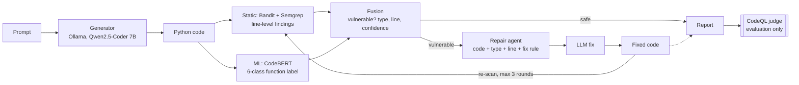

# Architecture

## Key separation
Bandit/Semgrep (and the ML model) **steer** the repair loop. CodeQL is used **only to measure** the
outcome. If the same tool both guided and judged repairs, the loop could simply learn to silence that
tool's rules, and our "after" numbers would be inflated.

## Module map
| Path | Responsibility |
|---|---|
| `src/codeguard/generator/` | Ollama HTTP client |
| `src/codeguard/detectors/static/` | Bandit/Semgrep wrappers → normalized findings |
| `src/codeguard/detectors/ml/` | VUDENC prep, CodeBERT training, inference |
| `src/codeguard/fusion/` | Combine static + ML into one decision |
| `src/codeguard/repair/` | Repair prompts and the max-3 loop |
| `src/codeguard/pipeline.py` | End-to-end orchestration |
| `src/codeguard/report.py` | Security report |
| `eval/` | Benchmark loaders, CodeQL judge, metrics |
| `api/`, `web/` | FastAPI backend, React (Vite) UI |

*Filled in further as phases land.*
