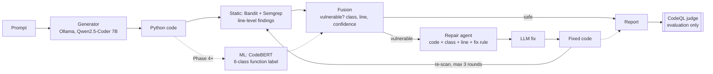

# Architecture

## Key separation
Bandit/Semgrep (and later the ML model) **steer** the repair loop. CodeQL is used **only to
measure** the outcome. If the same tool both guided and judged repairs, the loop could learn to
silence that tool's rules and the "after" numbers would be inflated.

## Data contracts (`src/codeguard/schemas.py`)
| Type | Produced by | Consumed by |
|---|---|---|
| `Finding` | each detector | fusion |
| `Detection` | fusion | repair loop, report |
| `RepairAttempt` | repair loop | report, eval |
| `Report` | pipeline | CLI, eval, (later) API |

## Module rules
1. Only `pipeline.py` knows the order of steps.
2. Detectors never import each other; fusion is the only place they meet.
3. `eval/` may import `codeguard`; `codeguard` never imports `eval/`.
4. The CLI holds no logic.
5. No hard-coded paths or model names: `configs/` + `.env` via `config.py`.

Rules 2–4 are checked automatically by `tests/unit/test_architecture.py`.

## Module map
| Path | Responsibility | Phase |
|---|---|---|
| `config.py`, `schemas.py`, `cli.py` | settings, shared types, CLI | 0 |
| `generator/` | Ollama client, prompts | 1 |
| `detectors/static/` | Bandit/Semgrep runners → normalized `Finding`s | 1 |
| `eval/benchmarks/`, `eval/judge/` | SecurityEval loader, CodeQL judge | 1 |
| `fusion/`, `repair/`, `report/`, `pipeline.py` | static fusion, repair loop, reports | 2 |
| `detectors/ml/` | VUDENC function extraction, dataset build | 3 |
